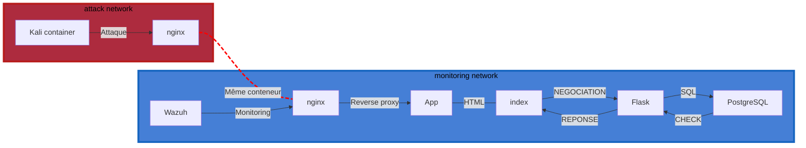

[](https://github.com/CubicPotato/Cyberlab/actions/workflows/ci.yml) [](https://www.python.org/)

**CyberLab** — Environnement Docker pédagogique pour tests de sécurité et monitoring

Ce dépôt contient une collection de services Docker destinés à construire un laboratoire d'exercices (CyberLab) :

- Une API simple en Flask (service `app`) avec authentification basique, consommée par une page de connexion statique.
- Un reverse-proxy `nginx` qui sert la page statique et transmet `/api/` vers l'API.
- Un service `db` PostgreSQL initialisé avec un utilisateur `admin` par défaut.
- Un conteneur `kali` (image Kali Linux) pour simuler une machine d'attaque dans le réseau `attack`.
- Un dossier `monitoring/` proposant un déploiement Wazuh (stack de surveillance) en mode single-node.

Ce README présente l'architecture, l'installation, l'utilisation et les tests du projet.

## Table des matières
- [Architecture](#architecture)
- [Prérequis](#prérequis)
- [Démarrage rapide (Docker)](#démarrage-rapide-docker)
- [Monitoring (Wazuh)](#monitoring-wazuh)
- [Utiliser la machine Kali](#utiliser-la-machine-kali)
- [Développement local (API)](#développement-local-api)
- [Tests](#tests)
- [Intégration continue](#intégration-continue)
- [Endpoints API](#endpoints-api)
- [Sécurité et limites connues](#sécurité-et-limites-connues)
- [Structure du dépôt](#structure-du-dépôt)
- [Pistes d'amélioration](#pistes-damélioration)

## Architecture

Le fichier de composition principal est [compose.yaml](compose.yaml). Il définit 4 services (`app`, `nginx`, `db`, `kali`), 2 réseaux et 2 volumes.

| Service | Réseau(x) | Port publié sur l'hôte | Rôle |
|---------|-----------|------------------------|------|
| `nginx` | `monitoring_network`, `star_wars` (attack) | `8080 → 80` | Seul point d'entrée : sert la page de login et proxifie `/api/` vers `app:8000` |
| `app`   | `monitoring_network` | aucun | API Flask, écoute sur `8000` en interne |
| `db`    | `monitoring_network` | aucun | PostgreSQL 18, écoute sur `5432` en interne |
| `kali`  | `star_wars` (attack) | aucun | Machine d'attaque, ne voit que `nginx` |

| Réseau | Nom Docker | Contenu |
|--------|------------|---------|
| `monitoring` | `monitoring_network` | `nginx`, `app`, `db` et la stack Wazuh (voir [Monitoring](#monitoring-wazuh)) |
| `attack` | `star_wars` | `kali` et `nginx` |

| Volume | Usage |
|--------|-------|
| `postgres_data` | Données PostgreSQL |
| `nginx_logs` (`cyberlab_nginx_logs`) | Logs nginx |

Les ports de l'API (`8000`) et de PostgreSQL (`5432`) ne sont **volontairement pas publiés** sur l'hôte : l'API n'est joignable qu'à travers `nginx`, et la base uniquement depuis le réseau interne. Cela garantit que le seul chemin d'attaque depuis Kali passe par `nginx`, là où le trafic est journalisé et surveillé par Wazuh.

Diagramme d'architecture (Mermaid)



## Prérequis
- Docker / Docker Compose v2 (Docker Desktop sous Windows/macOS)
- (Optionnel) Python 3.12 pour exécuter l'API ou les tests en local sans conteneurs
- Pour Wazuh : environ 4 Go de RAM disponibles pour Docker

## Démarrage rapide (Docker)

1. Copier le fichier d'environnement exemple et ajuster les variables si besoin :

```
cp .env.example .env
```

2. Construire et lancer l'ensemble du laboratoire (depuis la racine du dépôt) :

```
docker compose up --build -d
```

3. Accès :
- Page de connexion : `http://localhost:8080` (identifiants par défaut : `admin` / `12345`)
- API : `http://localhost:8080/api/...` (via `nginx`)

Pour arrêter et supprimer les conteneurs :

```
docker compose down          # conserve les données PostgreSQL
docker compose down -v       # supprime aussi les volumes (la base sera réinitialisée au prochain démarrage)
```

> Le script [db/init/init-db/init.sql](db/init/init-db/init.sql) (création de la table `users` et de l'utilisateur `admin`) n'est exécuté **qu'au premier démarrage**, quand le volume `postgres_data` est vide. Pour le rejouer, utiliser `docker compose down -v`.

## Monitoring (Wazuh)

Le dossier [monitoring/](monitoring) contient une stack Wazuh 4.14.3 séparée (manager, indexer, dashboard et un agent).

**Ordre de démarrage :** la stack Wazuh se branche sur le réseau `monitoring_network` déclaré comme `external`. Ce réseau est créé par le [compose.yaml](compose.yaml) principal : **il faut donc lancer le laboratoire principal avant Wazuh**.

1. (Linux uniquement) Augmenter `vm.max_map_count`, nécessaire à l'indexer :

```
sudo sysctl -w vm.max_map_count=262144
```

2. Préparer les variables d'environnement :

```
cd monitoring
cp .env.example .env
```

3. Générer les certificats TLS (une seule fois). Ils sont écrits dans `monitoring/single-node/config/wazuh_indexer_ssl_certs/` et ne sont pas versionnés (`*.pem` / `*.key` sont dans le `.gitignore`) :

```
cd single-node
docker compose -f generate-indexer-certs.yml run --rm generator
cd ..
```

4. Lancer la stack :

```
docker compose -f docker-compose.monitoring.yml up --pull always -d
```

5. Ouvrir le dashboard : `https://localhost` (port 443, certificat auto-signé). Les identifiants sont ceux de `INDEXER_USERNAME` / `INDEXER_PASSWORD` dans `monitoring/.env`. Le premier démarrage prend environ une minute.

**Fonctionnement :** l'agent Wazuh lit les logs JSON des conteneurs Docker (`/var/lib/docker/containers/*/*-json.log`) et écoute les événements Docker (`docker-listener`). Le décodeur [local_decoder.xml](monitoring/wazuh-manager/decoders/local_decoder.xml) extrait les champs des logs d'accès nginx. La règle [local_rules.xml](monitoring/wazuh-manager/rules/local_rules.xml) ne contient pour l'instant qu'une **règle de test** : une requête vers `/wazuh-chain-test-987656` doit lever une alerte de niveau 10, ce qui permet de vérifier toute la chaîne :

```
curl http://localhost:8080/wazuh-chain-test-987656
```

> L'agent monte `docker.sock`, `/etc` et `/var/log` de l'hôte en lecture seule. Ces chemins correspondent à un hôte Linux. Sous Docker Desktop (Windows/macOS), ils désignent la VM Linux de Docker Desktop, pas le système hôte.

## Utiliser la machine Kali

Le conteneur `cyberlab-kali` n'est relié qu'au réseau `attack` : il ne peut joindre que `nginx`. Il dispose de `curl`, `nmap`, `netcat`, `dig`, `ping`, etc.

```
docker exec -it cyberlab-kali bash

# depuis Kali :
nmap nginx
curl http://nginx/
curl -X POST -H "Content-Type: application/json" -d '{"login":"admin","password":"12345"}' http://nginx/api/login
```

Le conteneur reçoit uniquement les capacités `NET_RAW` et `NET_ADMIN` (nécessaires à `nmap` et aux outils réseau). Il ne tourne **pas** en mode `privileged`, ce qui limite ce qu'une commande lancée dans Kali peut faire sur l'hôte.

## Développement local (API)

L'API Flask se trouve dans [app/api/](app/api). Elle construit son URL de connexion PostgreSQL à partir des variables `DB_USER`, `DB_PASSWORD`, `DB_HOST`, `DB_PORT` et `DB_NAME` (voir [app/api/\_\_init\_\_.py](app/api/__init__.py)). Un fichier `.env` est aussi chargé automatiquement (`python-dotenv`), mais les variables déjà définies dans le shell restent prioritaires.

Comme le port `5432` n'est pas publié, une API lancée hors Docker ne peut pas joindre la base du compose. Pour le développement, créer un fichier `compose.override.yaml` (lu automatiquement par `docker compose`) qui publie la base **uniquement sur la boucle locale** :

```yaml
services:
  db:
    ports:
      - "127.0.0.1:5432:5432"
```

Puis, depuis la racine du dépôt :

```
python -m venv .venv
source .venv/bin/activate    # PowerShell: .venv\Scripts\Activate.ps1
pip install -r app/requirements.txt

docker compose up -d db

export DB_USER=postgres
export DB_PASSWORD=password
export DB_HOST=localhost      # et non "db", qui n'existe que dans le réseau Docker
export DB_PORT=5432
export DB_NAME=postgres

python -m flask --app app.api run --host 0.0.0.0 --port 8000
```

## Tests

Les tests se trouvent dans [app/tests/](app/tests) et utilisent `unittest`. Ils fonctionnent selon deux modes, choisis par la variable `TEST_TARGET` :

| Mode | `TEST_TARGET` | Base de données | Cible |
|------|---------------|-----------------|-------|
| local (par défaut) | `local` ou non défini | SQLite en mémoire, recréée pour chaque test avec l'utilisateur `admin` / `12345` | Client de test Flask, sans réseau ni Docker |
| prod | `prod` | PostgreSQL réel (`DB_*`) : la table `users` et l'utilisateur `admin` sont créés s'ils n'existent pas | Requêtes HTTP vers `PROD_BASE_URL` (par défaut `http://localhost:8080`) |

Exécution (depuis la racine du dépôt, après `pip install -r app/requirements.txt`) :

```
# mode local : rien d'autre à lancer
python -m unittest discover -s app/tests

# mode prod : contre le laboratoire lancé avec Docker
# (nécessite que PostgreSQL soit joignable, cf. compose.override.yaml ci-dessus)
TEST_TARGET=prod DB_HOST=localhost PROD_BASE_URL=http://localhost:8080 python -m unittest discover -s app/tests
```

## Intégration continue

Le workflow [.github/workflows/ci.yml](.github/workflows/ci.yml) s'exécute à chaque push ou pull request sur `main` / `master` :

1. démarre un service PostgreSQL 18 ;
2. installe les dépendances de [app/requirements.txt](app/requirements.txt) ;
3. lance l'API Flask en arrière-plan sur le port `8000` ;
4. exécute les tests en mode **prod** (`TEST_TARGET=prod`, `PROD_BASE_URL=http://127.0.0.1:8000`).

## Endpoints API

- POST `/api/login` — connexion via JSON `{"login": "user", "password": "pwd"}`. Retourne `{"login": "..."}` (200) si authentifié, `{"error": "invalid credentials"}` (401) sinon, `{"error": "missing credentials"}` (400) si un champ manque.
- GET `/api/me` — route protégée par HTTP Basic ; renvoie l'utilisateur courant `{"login": "..."}`, ou 401.

Exemples `curl` :

```
# login
curl -X POST -H "Content-Type: application/json" -d '{"login":"admin","password":"12345"}' http://localhost:8080/api/login

# accéder à /api/me avec basic auth
curl -u admin:12345 http://localhost:8080/api/me
```

## Sécurité et limites connues

L'application cible est minimaliste et **n'est pas sécurisée pour un usage réel**. Elle ne doit pas être exposée hors du laboratoire :

- les mots de passe sont stockés **en clair** dans la table `users` et comparés directement ;
- l'utilisateur par défaut `admin` / `12345` est créé à l'initialisation ;
- l'authentification `/api/me` repose sur HTTP Basic, sans HTTPS côté `nginx` ;
- l'API tourne avec le serveur de développement Flask ;
- les identifiants des fichiers `.env.example` (PostgreSQL et Wazuh) sont des valeurs par défaut à changer.

Mesures de cloisonnement en place :

- dans le laboratoire principal, seul `nginx` (8080) est exposé sur l'hôte. La stack Wazuh publie en plus le dashboard (443), l'indexer (9200) et les ports du manager (1514, 1515, 514/udp, 55000) ;
- l'API et la base ne sont joignables que depuis `monitoring_network` ;
- Kali est isolée dans le réseau `attack` et ne dispose que de `NET_RAW` / `NET_ADMIN`.

## Structure du dépôt
- [compose.yaml](compose.yaml) — composition principale (`app`, `nginx`, `db`, `kali`)
- [.env.example](.env.example) — variables d'environnement du laboratoire
- [app/](app) — application
	- [Dockerfile](app/Dockerfile)
	- [requirements.txt](app/requirements.txt)
	- [api/](app/api) — application Flask (routes, modèles, extensions, authentification)
	- [site/](app/site) — page de connexion (HTML + JS), servie par `nginx`
	- [tests/](app/tests) — tests unitaires
- [db/init/](db/init) — configuration PostgreSQL ([my-postgres.conf](db/init/my-postgres.conf)) et script d'initialisation ([init-db/init.sql](db/init/init-db/init.sql))
- [nginx/](nginx) — configuration et Dockerfile du reverse-proxy
- [kali/](kali) — Dockerfile de la machine d'attaque
- [monitoring/](monitoring) — stack Wazuh
	- [docker-compose.monitoring.yml](monitoring/docker-compose.monitoring.yml) — manager, indexer, dashboard, agent
	- [single-node/](monitoring/single-node) — configuration Wazuh et génération des certificats
	- [wazuh-agent/](monitoring/wazuh-agent) — image et configuration de l'agent
	- [wazuh-manager/](monitoring/wazuh-manager) — décodeurs et règles personnalisés
- [.github/workflows/ci.yml](.github/workflows/ci.yml) — intégration continue

## Pistes d'amélioration
- **Détection Wazuh** : ajouter de vraies règles en plus de la règle de test, par exemple une rafale de 401 sur `/api/login` (bruteforce), de nombreux 404 ou le user-agent nmap (scan), des motifs d'injection SQL dans les URL. Puis documenter un scénario « attaque depuis Kali → alerte visible dans le dashboard ».
- **Mots de passe** : les hacher (`werkzeug.security.generate_password_hash` / `check_password_hash`).
- **Production** : servir l'API avec `gunicorn` plutôt qu'avec le serveur de développement Flask, et sortir `requests` (utilisé uniquement par les tests) de l'image.
- **Santé des services** : ajouter un `healthcheck` à `db` et `depends_on: condition: service_healthy` à `app`.
- **CI** : l'étape « Wait for Flask » fait un `GET` sur `/api/login`, qui n'accepte que `POST` (réponse 405). La boucle attend donc toujours ses 30 secondes.
- **Nettoyage** : [db/init/compose.yaml](db/init/compose.yaml) fait doublon avec le compose principal. Dans [kali/dockerfile](kali/dockerfile), `rm -rf /var/lib/apt/lists[]` devrait être `/var/lib/apt/lists/*`. La fonction `_connect_postgres` est dupliquée dans les deux fichiers de test.
